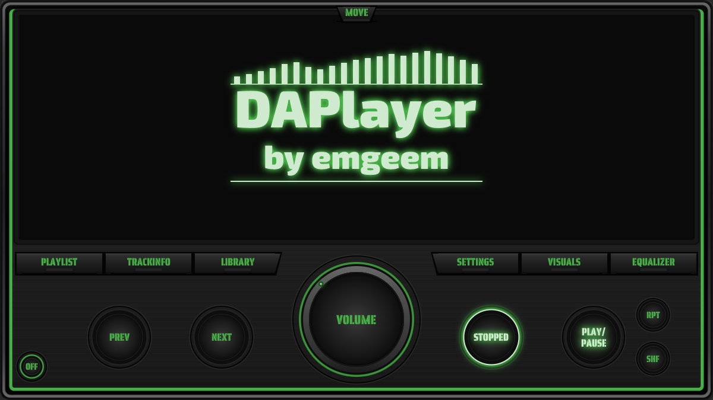
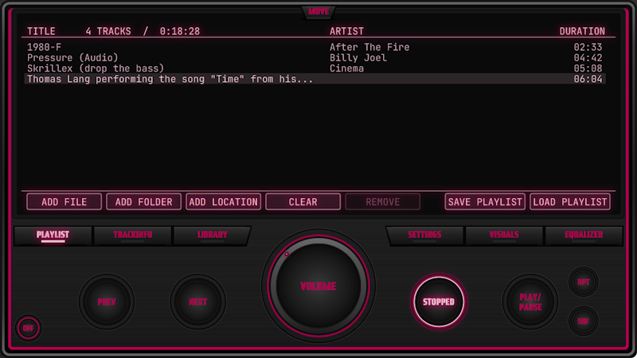
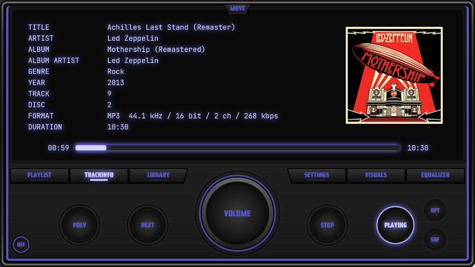
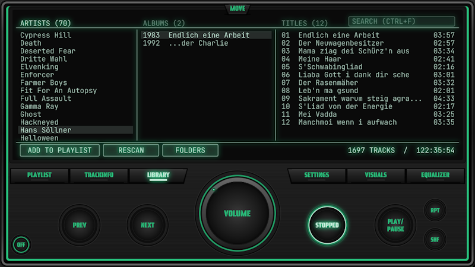
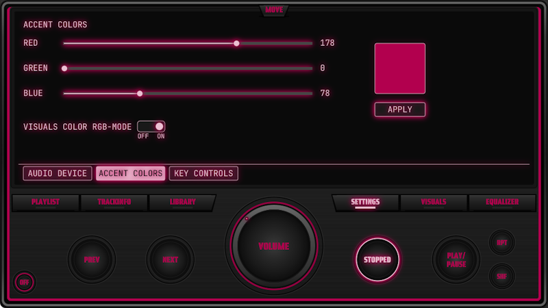
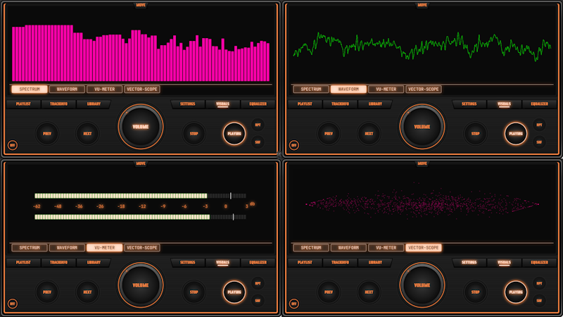
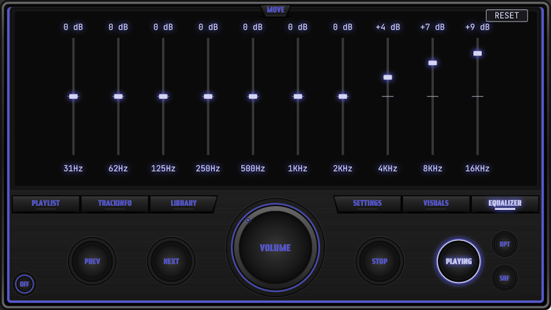

# DAPlayer


DAPlayer is a JavaFX-based desktop audio player for playing and managing
WAV, MP3, FLAC, OGG, Opus, M4A/AAC, AIFF, WMA, APE and WavPack files as well
as network streams (internet radio). A built-in music library keeps track of
all songs in your music folders and makes them searchable.

The project is developed as a native desktop application and is intended
to run locally without SaaS dependencies.

The entire player interface is drawn by hand on JavaFX canvases in the style
of a hi-fi component; no standard JavaFX controls are used inside the player.

## Version

Current version: **0.4.2**

## Screenshots

| Playlist | Track information |
|---|---|
|  |  |

| Music library | Color settings |
|---|---|
|  |  |

| Visuals | Equalizer |
|---|---|
|  |  |

## Features

### Audio Playback

- WAV playback (8/16/24/32 bit integer, 32/64 bit float, WAVE_FORMAT_EXTENSIBLE)
- MP3 playback
- FLAC, OGG/Vorbis, Opus, M4A/AAC, AIFF, WMA, APE, WavPack playback (FFmpeg)
- Network streams / internet radio (http, https, …)
- Multichannel files are downmixed to stereo
- Play / Pause / Resume
- Stop
- Automatic transition to the next track
- Automatic stop at the end of the playlist
- Volume control
- Mute functionality
- Audio output device selection
- Shuffle playback mode
- Repeat playback mode

### Music Library

- LIBRARY display with three columns: **ARTISTS | ALBUMS | TITLES**
- Albums with year, tracks with track number and duration
- Library folders are managed in the **FOLDERS** view (add / remove);
  unreachable folders are marked **OFFLINE**
- **RESCAN** runs in the background with progress display and can be cancelled
- Incremental scan: only new or changed files are read again
- Offline protection: tracks on disconnected drives are not removed
- Search field (**CTRL+F**): all words of the query must match, results are
  shown as `Artist - Title [Album]`
- **ADD TO PLAYLIST** adds the selected track, the whole album or all search
  results; double-click / ENTER adds a single track
- Consistent artist names (most frequent spelling, album artist preferred)
- Tracks without album tag are grouped by folder name
- Sorting according to German collation rules

### Playlist

- File chooser
- Folder-based file selection (recursive, sorted, loaded in the background)
- ADD LOCATION: add a URL, file or folder by typing it
- Drag & drop of files, folders, playlists and URLs
- Double-click / ENTER plays a track, REMOVE / DELETE removes it
- Save and load playlists (`.daplist`, `.m3u`, `.m3u8`)
- The last session's playlist is restored on start
- Playlist management
- Track selection
- Track navigation
- Automatic next-track playback
- Shuffle playback
- Repeat playback

### Track Information

- Track metadata display
- Album artwork display
- Track list
- Track information display
- Current playback position
- Total track duration

### Playback Progress

- Visual playback progress bar
- Mouse-based seeking
- WAV seeking
- MP3 seeking
- WMA seeking

### Keyboard Controls

| Key | Action |
|---|---|
| SPACE | Play / Pause |
| S | Stop |
| N / PAGE DOWN | Next track |
| B / PAGE UP | Previous track (restarts the track after 3 s) |
| LEFT / RIGHT | Seek -5 / +5 s (with SHIFT: 30 s); in LIBRARY: switch column |
| + / - | Volume |
| UP / DOWN | Volume (in PLAYLIST and LIBRARY: move selection) |
| ENTER | Play selected track (PLAYLIST) / add to playlist (LIBRARY) |
| DELETE | Remove selected track (PLAYLIST) / remove selected folder (LIBRARY / FOLDERS) |
| ESC | Clear search / leave FOLDERS (LIBRARY) |
| M | Mute |
| H / R | Shuffle / Repeat |
| 1 – 6 | Playlist / Trackinfo / Library / Settings / Visuals / Equalizer |
| CTRL+F | Search in the library (LIBRARY) |
| CTRL+O / CTRL+SHIFT+O | Add files / add folder |
| CTRL+L | Add location (URL) |
| CTRL+S / CTRL+Q | Save playlist / quit |

While the library search field has the focus, all keys are used for typing.
Media keys (play, stop, next, previous, mute, volume) are supported as well.
The list is also shown under SETTINGS / KEY CONTROLS.

### Equalizer

DAPlayer includes a real-time 10-band graphic equalizer.
RESET sets all bands to 0 dB, a double-click resets a single band.

Available frequency bands:

- 31 Hz
- 62 Hz
- 125 Hz
- 250 Hz
- 500 Hz
- 1 kHz
- 2 kHz
- 4 kHz
- 8 kHz
- 16 kHz

Gain range:

- -12 dB to +12 dB

Equalizer settings are stored persistently using Java Preferences.

### Audio Visualizations

DAPlayer includes a dedicated Visuals display with four visualization modes:

- Spectrum
- Waveform
- VU-Meter
- Vectorscope

The visualization system receives real-time audio data from the audio engine.

The VU-Meter uses separate left and right channel peak and RMS values.

The Vectorscope uses separate left and right channel sample data for
stereo visualization.

DAPlayer also supports an RGB visualization mode.

### User Interface

The player uses a custom JavaFX interface with:

- Custom player background
- Custom volume knob
- Playback control buttons
- Menu buttons
- Off and navigation buttons
- Start display
- Track list display
- Track information display
- Music library display
- Settings display
- Equalizer display
- Visuals display
- Custom accent colors
- Playback state indication

The playback controls provide visual feedback for:

- PLAYING
- PAUSED
- STOPPED

## Settings

Settings are stored in

- Windows: `%APPDATA%\emgeem\DAPlayer`
- macOS: `~/Library/Application Support/emgeem/DAPlayer`
- Linux: `~/.config/emgeem/DAPlayer`

and via Java Preferences (volume, shuffle, repeat, accent color, equalizer).

### Music Library

The library (folders and track data) is stored as `library.json` in the
settings directory. It is saved atomically via a temporary file; if the file
is damaged, it is kept as `library.json.broken` and an empty library is used.
Compilations are detected automatically and grouped under VARIOUS ARTISTS.

### Audio Device

DAPlayer allows the user to select the audio output device. Changing the
device during playback continues the current track at the same position.
If no device is available, the system default device is used.

### Accent Colors

The accent color can be changed through the Settings display.

The selected accent color is stored persistently.

### Equalizer

Equalizer settings are stored persistently and restored when DAPlayer
is started again.

## Supported Audio Formats

Currently supported:

- WAV
- MP3
- FLAC
- OGG / Vorbis, Opus
- M4A / AAC
- AIFF
- WMA
- APE, WavPack
- Musepack
- Network streams (http, https)

### FFmpeg formats

WMA, FLAC, OGG, Opus, M4A/AAC, AIFF, APE, WavPack, Musepack and network streams are
decoded by `FfmpegDecoder` using FFmpeg through JavaCPP. Any sample format is
converted to 16-bit PCM with libswresample.

Supported functionality includes:

- Audio decoding
- Metadata reading
- Track duration
- Playback
- Seeking
- Pause / Resume
- Automatic track transition

## Technologies

DAPlayer is built using:

- Java 21
- JavaFX 24.0.2
- Maven
- JAudioTagger 3.0.1
- JLayer 1.0.1
- FFmpeg 8.1.2 via JavaCPP
- Gson 2.11.0

## Project Structure

```text
src/main/java/de/emgeem/daplayer/
├── Main
├── audio/        AudioDeviceManager, AudioEngine, Equalizer, EqualizerSettings,
│                 PlayerController, VisualizationData, VisualizationListener
├── decoder/      AudioDecoder, DecoderManager, WavDecoder, Mp3Decoder,
│                 FfmpegDecoder, TagReader
├── library/      LibraryStore, LibraryScanner, MediaLibrary
├── model/        Playlist, Track, LibraryEntry
├── playlist/     PlaylistManager
├── util/         AppPaths
└── ui/           DAPlayerView, KeyBindings
    ├── background/  PlayerPanel, PlayerViewBackground
    ├── control/     MenuButton, OffButton, PlayModeButton, RoundControlButton, VolumeKnob
    ├── painter/     UiColors
    └── display/     PlayerDisplay, StartDisplay, TrackListDisplay, TrackInfoDisplay,
                     LibraryDisplay, SettingsDisplay, AudioDeviceSettings,
                     AccentColorSettings, KeyControlsSettings, EqualizerDisplay,
                     VisualsDisplay, ArtworkManager
        └── visual/  SpectrumVisualization, WaveformVisualization, VuVisualization, VectorScope
```

Resources such as fonts and application icons are located under:

```text
src/main/resources/
```

Screenshots for this README are located under:

```text
docs/screenshots/
```

## Prerequisites

- Java JDK 21 or higher
- Maven 3.9.x or higher

DAPlayer uses JLayer 1.0.1 for MP3 playback.
Since this version is not normally obtained via Maven Central, the
required JAR file is located in the `lib/` directory.

## Installation

Clone or download the repository.

Then, install JLayer 1.0.1 into the local Maven repository:

```bash
mvn install:install-file "-Dfile=lib/jlayer-1.0.1.jar" "-DgroupId=javazoom" "-DartifactId=jlayer" "-Dversion=1.0.1" "-Dpackaging=jar"
```

All other dependencies (JavaFX, JAudioTagger, FFmpeg, Gson) are downloaded
automatically by Maven.

## Building

The project uses Maven.

To compile the project:

```bash
mvn clean package
```

To start the application using the JavaFX Maven plugin:

```bash
mvn javafx:run
```

## Getting Started with the Library

1. Open **LIBRARY** (menu button or key `3`)
2. Click **FOLDERS**, then **ADD FOLDER** and choose your music folder
3. The scan starts automatically; the progress is shown in the status line
4. Click **BACK** (or press ESC) and browse by artist and album,
   or search with **CTRL+F**

## Current Development Status

Version **0.4.2** currently provides:

- WAV, MP3, FLAC, OGG, Opus, M4A, AIFF, WMA, APE, WavPack, musepack playback
- Network streams
- Music library with folder management, background scan and search
- Keyboard controls and drag & drop
- Playlist handling (M3U, session restore)
- Track navigation
- Automatic next-track playback
- Automatic playlist stop
- Shuffle playback
- Repeat playback
- Volume control
- Mute functionality
- Audio device selection
- Track information
- Album artwork
- Playback progress
- WAV seeking
- MP3 seeking
- WMA seeking
- Audio equalizer
- Persistent equalizer settings
- Spectrum visualization
- Waveform visualization
- VU-Meter visualization
- Vectorscope visualization
- RGB visualization mode
- Audio device settings
- Accent color settings
- Playback state indication

The project is still under active development. Architecture, user interface and playback functionality may change in future versions.

## Planned Development

Possible future development includes:

- Exception list for artist name capitalization (e.g. ABBA, AC/DC)
- Configurable key bindings
- Further expansion of the player functionality
- Further expansion of the user interface

## License

DAPlayer is released under the [MIT License](LICENSE).

Third-party components keep their own licenses:

- JLayer 1.0.1 (`lib/`): GNU Lesser General Public License (LGPL)
- Fonts (`src/main/resources/fonts/`), all under the SIL Open Font License 1.1:
  - Exo 2
  - JetBrains Mono
  - Saira Stencil
- Maven dependencies (JavaFX, JAudioTagger, FFmpeg via JavaCPP, Gson):
  see their respective projects